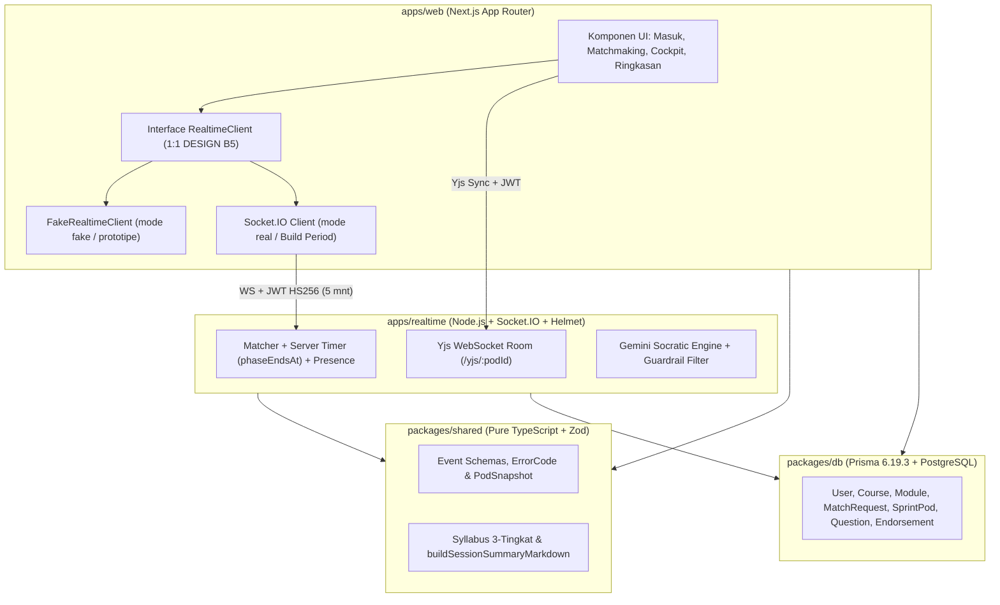
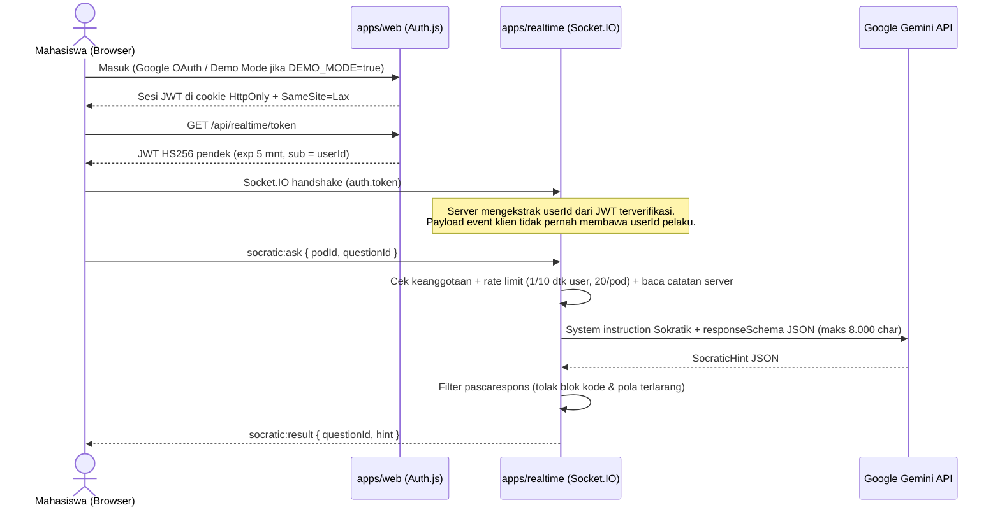
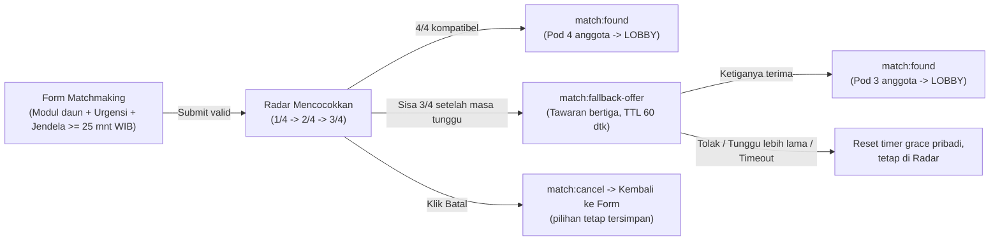
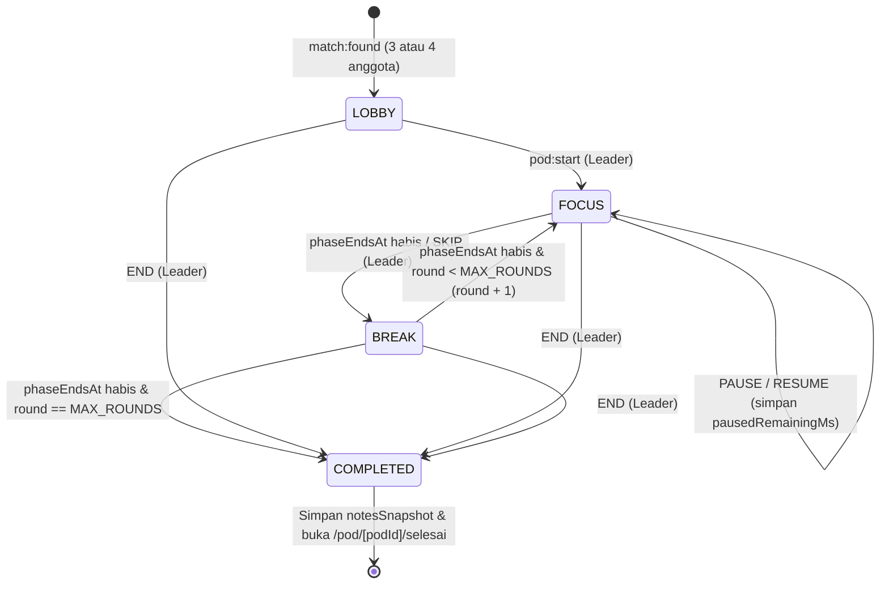

# Arsitektur Teknis SyncPod

Dokumen ini merangkum arsitektur sistem, batas dependensi monorepo, alur pencocokan (*matchmaking*), siklus sprint pod, dan batas keamanan yang bersumber dari [`DESIGN.md`](DESIGN.md), [`PRD.md`](PRD.md), dan [`DECISIONS.md`](DECISIONS.md).

---

## 1. Batas Paket & Pemisahan Transport (`D18`, `D19`)

SyncPod memisahkan **Next.js App Router (`apps/web`)** dari **Server Realtime stateful (`apps/realtime`)** karena koneksi WebSocket/Socket.IO berumur panjang dan state timer/Yjs di memori tidak cocok berjalan di lingkungan serverless.

- **`apps/*` -> `packages/*`:** `packages/shared` tidak mengimpor `@prisma/client` maupun API browser sehingga aman dipakai oleh klien, server, dan unit test.
- **Mode Prototipe (`fake`) vs Produksi (`real`):** Antarmuka `RealtimeClient` menjaga seluruh komponen UI terpisah dari detail transport sehingga perpindahan ke Socket.IO tidak mengubah struktur layar.

---

## 2. Alur Autentikasi & Keamanan (`NFR-4`, `DESIGN B4 & B10`)

**Invarian Keamanan Wajib:**
- Kunci rahasia (`GEMINI_API_KEY`, `REALTIME_JWT_SECRET`, `AUTH_SECRET`) hanya hidup di environment server — nol variabel `NEXT_PUBLIC_*` berisi rahasia.
- Konten `<session_notes>` dan `<question>` diperlakukan sebagai data tidak tepercaya (*untrusted student data*) dan dibatasi 8.000 karakter terakhir (`FR-4.3`).
- Pratinjau Markdown di browser disanitasi dengan `react-markdown` + `rehype-sanitize` (`FR-3.2`).

---

## 3. Alur Matchmaking & Fallback Bertiga (`FR-2.1` – `FR-2.4`, `D6`, `D7`)

---

## 4. Siklus Hidup Sprint Pod & Sinkronisasi Timer (`DESIGN B6`)

Server **tidak** menyiarkan detak detik setiap detik (`timer:tick`), melainkan menyimpan **`phaseEndsAt`** (UTC epoch ms) dan **`pausedRemainingMs`**. Klien menyelaraskan jam lokal melalui 5 kali `time:ping` (memilih RTT terkecil) lalu menghitung mundur secara lokal setiap 250 ms (`NFR` akurasi selisih ≤ 1 detik).

---

## 5. Ringkasan Design System (`DESIGN.md` Part A)

- **Satu elemen utama (`PodRing`):** Cincin SVG 4 kursi (posisi pukul 12, 3, 6, 9) berubah peran secara konsisten dari **Radar pencarian** di `/pod` menjadi **Timer & bar kehadiran** di `/pod/[podId]`.
- **Palet Gelap Semantik (Kontras AA terverifikasi):**
  - Permukaan: `--bg-canvas` (`#090D16`), `--bg-surface` (`#0F172A`), `--bg-surface-elevated` (`#1E293B`)
  - Semantik: `--color-primary` (Fokus/Aksi), `--color-amber` (Istirahat/Peringatan), `--color-emerald` (Hadir/Selesai), `--color-purple` + `--color-purple-text` (Khusus konten AI Pemandu), `--color-danger` (Galat)
- **Tipografi Self-Hosted (`@fontsource-variable/*`):** `Bricolage Grotesque` (heading), `Plus Jakarta Sans` (body 15px), `JetBrains Mono` dengan `tabular-nums` (timer, statistik, editor CodeMirror).

