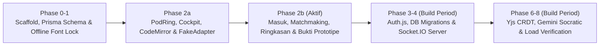

# Indeks Dokumentasi SyncPod

Direktori `Docs/` menjadi pusat spesifikasi produk, arsitektur teknis, keputusan desain (ADR), rencana kerja fase, dan naskah demo **SyncPod** (Tim **Cah Kacawww**, ITATS — GDGoC ITB STACK 2026 Case 1).

## Aturan Precedence (Sumber Kebenaran)

Jika ditemukan perbedaan antar dokumen, ikuti urutan otoritas berikut tanpa menebak:

1. **[`DECISIONS.md`](DECISIONS.md)** *(ADR D1–D32)* — Mengikat dan menimpa butir spesifik di `PRD.md` maupun `DESIGN.md`.
2. **[`PRD.md`](PRD.md)** — Mengatur **perilaku produk**, prioritas (P0/P1/P2), out-of-scope, dan kriteria penerimaan (*acceptance criteria*).
3. **[`DESIGN.md`](DESIGN.md)** — Mengatur **desain visual**, token warna/tipografi (Part A), skema database, kontrak event Socket.IO, dan arsitektur teknis (Part B).

> [!CAUTION]
> Folder [`archive-v1/`](archive-v1/README.md) berstatus **SUPERSEDED (v1.0)** sesuai **D1** dan tidak digunakan sebagai acuan implementasi v2.0.

---

## Peta Berkas Dokumentasi

| Dokumen | Peran | Audiens Utama |
|---|---|---|
| [`PRD.md`](PRD.md) | Masalah, persona, metrik sukses (≤ 120 detik), scope P0–P2, & FR/NFR | Semua anggota tim & reviewer |
| [`DESIGN.md`](DESIGN.md) | Design system (`PodRing`, token warna AA, font self-host) + kontrak event B5, Yjs, & Gemini | Frontend, Realtime, & QA |
| [`DECISIONS.md`](DECISIONS.md) | Catatan keputusan terkunci **D1–D32** (pin toolchain, adapter fake vs real, aturan kontrak) | Engineer & coding agent |
| [`ARCHITECTURE.md`](ARCHITECTURE.md) | Panduan visual arsitektur, alur matchmaking, state machine pod, & batas keamanan | Kontributor baru & juri teknis |
| [`DEMO_SCRIPT.md`](DEMO_SCRIPT.md) | Naskah shot-by-shot video demo 2 menit (120 detik) beserta batasan klaim D32 | Presenter & tim video |
| [`plans/phase-2b-plan.md`](plans/phase-2b-plan.md) | Rencana penyelarasan Phase 2b (Part M & Part S) + decision points | Reviewer & pelaksana Stage B |

---

## Peta Jalan Implementasi

- **Semifinal (30 Nov):** Fokus pada prototipe terverifikasi (`NEXT_PUBLIC_REALTIME_MODE=fake`) lengkap dengan bukti UI, kontrak deterministik, aksesibilitas, dan build offline tanpa CDN.
- **Build Period:** Mengimplementasikan backend `real` pada `apps/realtime` dan `packages/db` menggunakan antarmuka `RealtimeClient` serta kontrak event yang sama persis (`DESIGN.md` B5).
