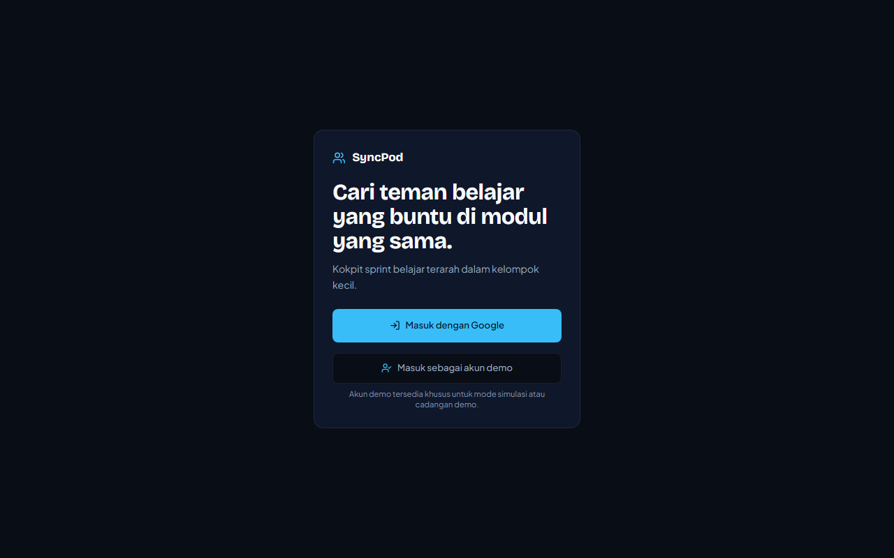
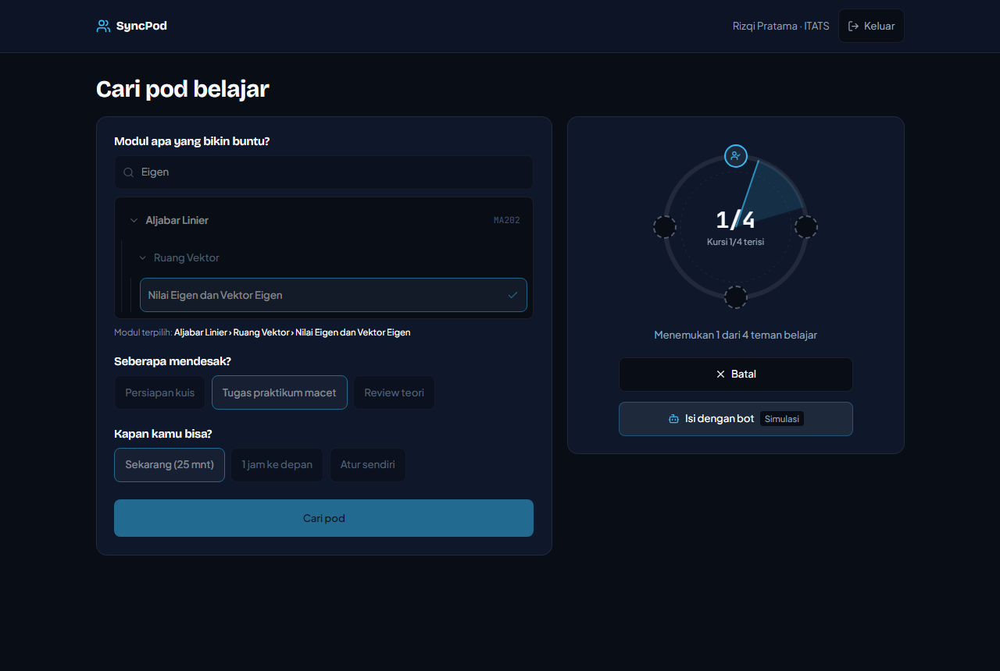
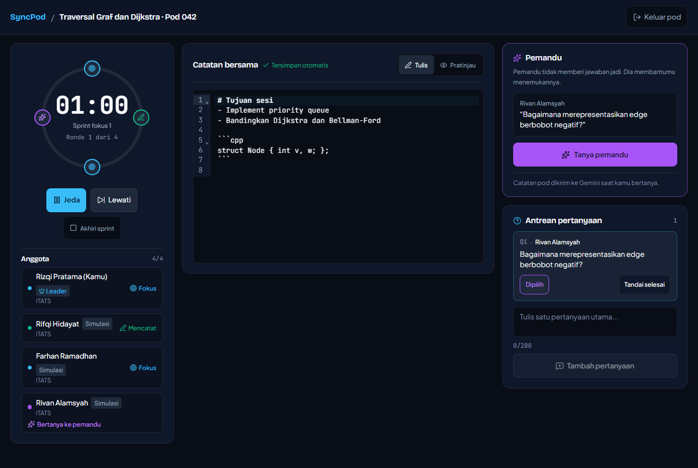
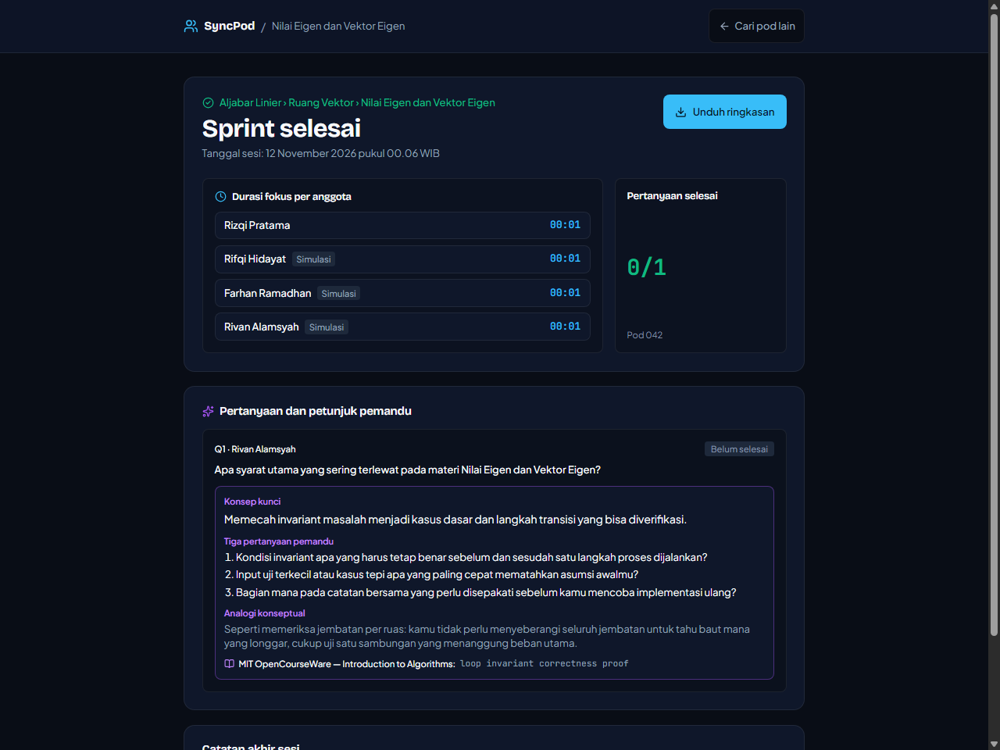
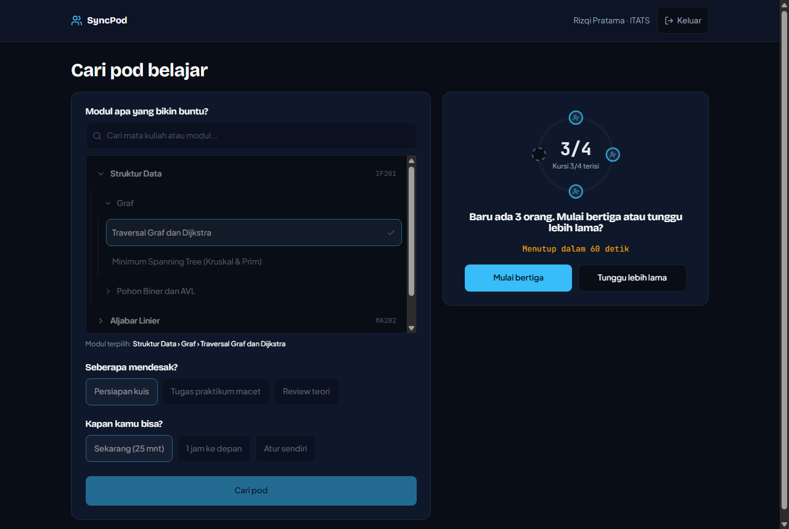
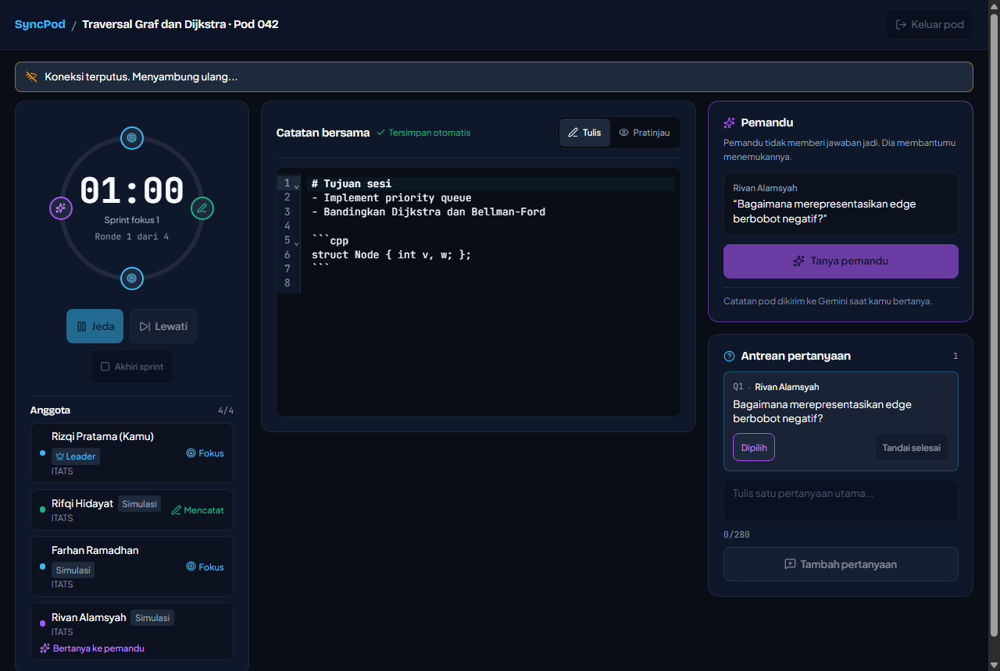
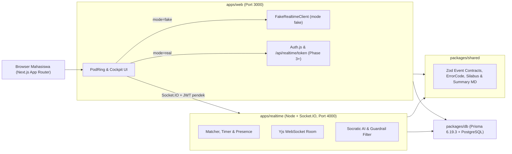

<div align="center">

# SyncPod

**Automated Micro-Study Pod & Socratic AI Collaborative Sprint Platform**

Dibangun oleh **Tim Cah Kacawww** (Institut Teknologi Adhi Tama Surabaya)  
untuk **GDGoC ITB STACK 2026 — Case 1: Smarter Campus and Learning**


[Dokumentasi (`Docs/`)](Docs/README.md) · [Arsitektur](Docs/ARCHITECTURE.md) · [Naskah Demo](Docs/DEMO_SCRIPT.md) · [Panduan Kontribusi](CONTRIBUTING.md) · [Keamanan](SECURITY.md)

</div>

---

## Ringkasan Masalah & Solusi

Mahasiswa teknik dan komputasi semester awal sering terhenti pada satu modul spesifik (*traversal graf*, *ruang vektor*, *deadlock*). Belajar kelompok membantu, tetapi gagal di awal karena tiga biaya gesekan: mencari teman pada modul yang sama, menyamakan jadwal secara manual, dan tergoda AI umum yang langsung memberi jawaban instan.

| Gesekan Awal | Solusi SyncPod | Implementasi Kunci |
|---|---|---|
| **Mencari rekan sepemahaman modul** | Pencocokan otomatis berbasis taksonomi silabus 3 tingkat (`Course -> Topik -> Modul daun`) & jendela waktu hari ini (WIB) | Layar Matchmaking + `PodRing` Radar (3–4 anggota, opsi *fallback* bertiga 60 detik) |
| **Koordinasi sprint yang berantakan** | Satu ruang kerja serempak: timer fokus/istirahat, status kehadiran, catatan Markdown bersama, dan antrean 1 pertanyaan/anggota | `Cockpit` responsif dengan koreksi offset jam server & sanitasi pratinjau |
| **Ketergantungan jawaban instan AI** | Pemandu Sokratik berbasis konteks modul & catatan bersama: tepat **3 pertanyaan pemandu**, **1 analogi konseptual**, tanpa blok kode solusi | Server-side Gemini Engine + filter anti-menyontek & batas kuota |

> [!NOTE]
> **Transparansi Status Prototipe (`NEXT_PUBLIC_REALTIME_MODE`):**
> - **Mode `fake` (Prototipe Semifinal):** Berjalan mandiri di `apps/web` memakai `FakeRealtimeClient` deterministik tanpa jaringan eksternal. Anggota simulasi ditandai eksplisit sebagai **`Simulasi`**.
> - **Mode `real` (Build Period):** Menghubungkan autentikasi Google/demo Auth.js, PostgreSQL + Prisma, server Socket.IO (`apps/realtime`), Yjs CRDT, dan API Gemini di sisi server.

---

## Pratinjau Antarmuka (Verified Proof)

Seluruh tangkapan layar di bawah diambil langsung dari browser headless pada viewport `1280px` menggunakan font self-hosted lokal (tanpa permintaan CDN eksternal).

| 1. Masuk (`/masuk`) | 2. Radar Matchmaking (`/pod`) |
|---|---|
|  |  |
| **3. Sprint Cockpit (`/pod/[podId]`)** | **4. Ringkasan Pascasprint (`/pod/[podId]/selesai`)** |
|  |  |

<details>
<summary>Lihat variasi state sistem (Fallback Bertiga & Connection Banner)</summary>

| Tawaran Mulai Bertiga (`3/4`) | Banner Koneksi Terputus (`Cockpit`) |
|---|---|
|  |  |

</details>

---

## Arsitektur Monorepo

`apps/*` hanya bergantung pada `packages/*`, sedangkan `packages/shared` terisolasi murni tanpa dependensi Prisma atau browser agar kontrak event Socket.IO dan skema Zod tetap tunggal.



### Struktur Direktori

| Paket / Folder | Peran | Teknologi Utama |
|---|---|---|
| [`apps/web`](apps/web/package.json) | Frontend App Router, `PodRing`, Sprint Cockpit, CodeMirror Markdown & adapter realtime | Next.js `16.4.6`, React `19.3.1`, Tailwind CSS v4, CodeMirror 6, `@fontsource-variable/*` |
| [`apps/realtime`](apps/realtime/package.json) | Server Node terpisah untuk health check, matchmaking, timer, Yjs, & Gemini | Node.js `26.8.1`, Socket.IO `4.8.4`, Helmet `8.3.0` |
| [`packages/shared`](packages/shared/package.json) | Sumber kebenaran tipe event B5, skema Zod, fixture silabus, & ekspor ringkasan | TypeScript `6.0.3`, Zod `4.6.7`, Vitest `5.1.0` |
| [`packages/db`](packages/db/package.json) | Skema PostgreSQL (`User`, `Course`, `Module`, `MatchRequest`, `SprintPod`, `Question`, `Endorsement`) | Prisma `6.19.3` |
| [`Docs/`](Docs/README.md) | Spesifikasi PRD, Design System & Arsitektur, ADR (`DECISIONS.md`), rencana fase, & naskah demo | Markdown + Mermaid |
| [`proof/`](proof/) | Bukti verifikasi mentah per fase (`typecheck`, `lint`, `test`, `build`, offline build, screenshot CDP) | Log & PNG |
| [`scripts/`](scripts/) | Utilitas verifikasi lokal (mis. `block-network.cjs` untuk uji build offline) | Node.js |

---

## Prasyarat

- **Node.js:** `26.8.1` (sesuai `.nvmrc`, minimum `>= 20.9.0`)
- **pnpm:** `12.8.1` (terkunci pada `packageManager` di root `package.json`; aktifkan via `corepack enable`)
- **Docker:** Opsional untuk PostgreSQL lokal (dibutuhkan mulai Phase 3 / Build Period)

---

## Menjalankan Secara Lokal

### 1. Mode Prototipe (Tanpa Database & Tanpa Internet)

Cocok untuk demo semifinal atau meninjau seluruh alur antarmuka (`/masuk` -> `/pod` -> `/pod/[podId]` -> `/pod/[podId]/selesai`):

```bash
pnpm install --frozen-lockfile
```

Jalankan build/dev dalam mode `fake` (Linux / macOS bash):

```bash
NEXT_PUBLIC_REALTIME_MODE=fake NEXT_TELEMETRY_DISABLED=1 pnpm --filter @syncpod/web... dev
```

Atau di **Windows PowerShell**:

```powershell
$env:NEXT_PUBLIC_REALTIME_MODE = "fake"
$env:NEXT_TELEMETRY_DISABLED = "1"
pnpm --filter @syncpod/web... dev
```

Buka `http://localhost:3000` (otomatis mengarah ke `/masuk`). Tambahkan `?scenario=fallback` pada `/pod` untuk mencoba alur tawaran bertiga, atau `?demo=1` untuk kontrol demo cepat.

### 2. Monorepo Lengkap & Quality Gate

```bash
cp .env.example .env
pnpm install --frozen-lockfile
pnpm -r typecheck
pnpm -r lint
pnpm -r test
pnpm -r build
```

Untuk menjalankan server web + realtime secara paralel:

```bash
pnpm dev
```

- **Web:** `http://localhost:3000`
- **Realtime health check:** `http://localhost:4000/health`

---

## Mode Offline (Uji Venue Tanpa Internet)

Seluruh font (`Bricolage Grotesque`, `Plus Jakarta Sans`, `JetBrains Mono`) dibundel secara lokal melalui `@fontsource-variable/*` — **nol** request ke `fonts.googleapis.com` atau CDN eksternal.

Untuk memverifikasi build prototipe tanpa akses internet (Wi-Fi dimatikan setelah `pnpm install --frozen-lockfile`):

1. Matikan koneksi internet / Wi-Fi pada perangkat.
2. Jalankan build paket bersama dan web dalam mode `fake`:

```powershell
# Windows PowerShell
$env:NEXT_PUBLIC_REALTIME_MODE = "fake"
$env:NEXT_TELEMETRY_DISABLED = "1"
pnpm --filter @syncpod/web... build
pnpm --filter @syncpod/web start
```

```bash
# Linux / macOS
NEXT_PUBLIC_REALTIME_MODE=fake NEXT_TELEMETRY_DISABLED=1 pnpm --filter @syncpod/web... build
pnpm --filter @syncpod/web start
```

3. Buka `http://localhost:3000` dan telusuri alur `/masuk` -> `/pod` -> `/pod/pod-042` -> `/pod/pod-042/selesai`.

---

## Deploy prototipe (Vercel)

Untuk men-deploy prototipe frontend standalone ke Vercel (mode simulasi, tanpa server realtime/database):

| Pengaturan Vercel | Nilai |
|---|---|
| **Framework Preset** | Next.js |
| **Root Directory** | `apps/web` *(atau root monorepo jika memakai command di bawah)* |
| **Install Command** | `pnpm install --frozen-lockfile` |
| **Build Command** | `pnpm --filter @syncpod/web... build` |
| **Environment Variables** | `NEXT_PUBLIC_REALTIME_MODE=fake` dan `NEXT_TELEMETRY_DISABLED=1` |

> [!IMPORTANT]
> Pastikan **Root Directory** mengarah tepat sesuai strategi build monorepo: jika memakai command `pnpm --filter @syncpod/web... build`, jalankan dari **root repository** agar paket `@syncpod/shared` ikut ter-build otomatis sebagai dependensi workspace (`...`).

---

## Tim Pengembang

**Tim Cah Kacawww** — Institut Teknologi Adhi Tama Surabaya (ITATS)  
Peserta **GDGoC ITB STACK 2026 — Case 1: Smarter Campus and Learning**

> *Lihat [`Docs/README.md`](Docs/README.md) untuk daftar lengkap spesifikasi produk, arsitektur teknis, keputusan desain (ADR), dan bukti verifikasi per fase.*
